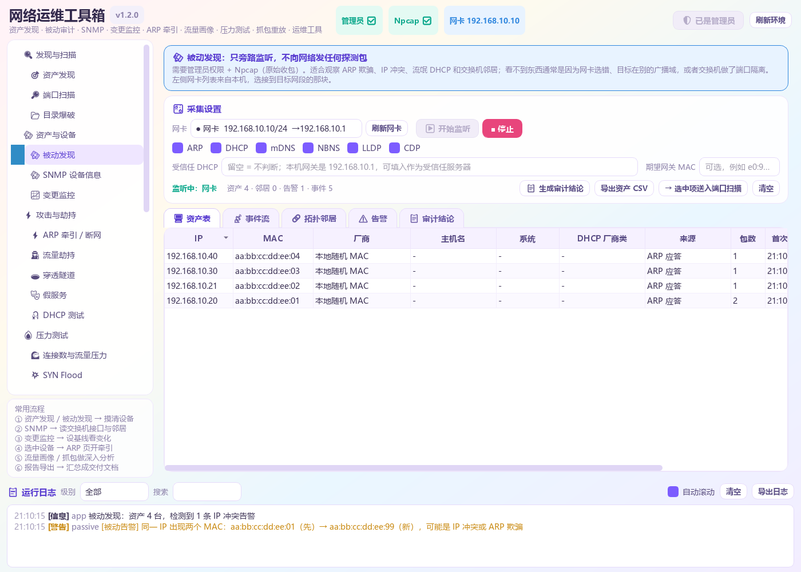
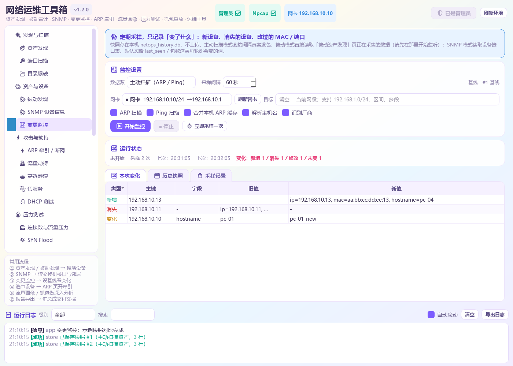
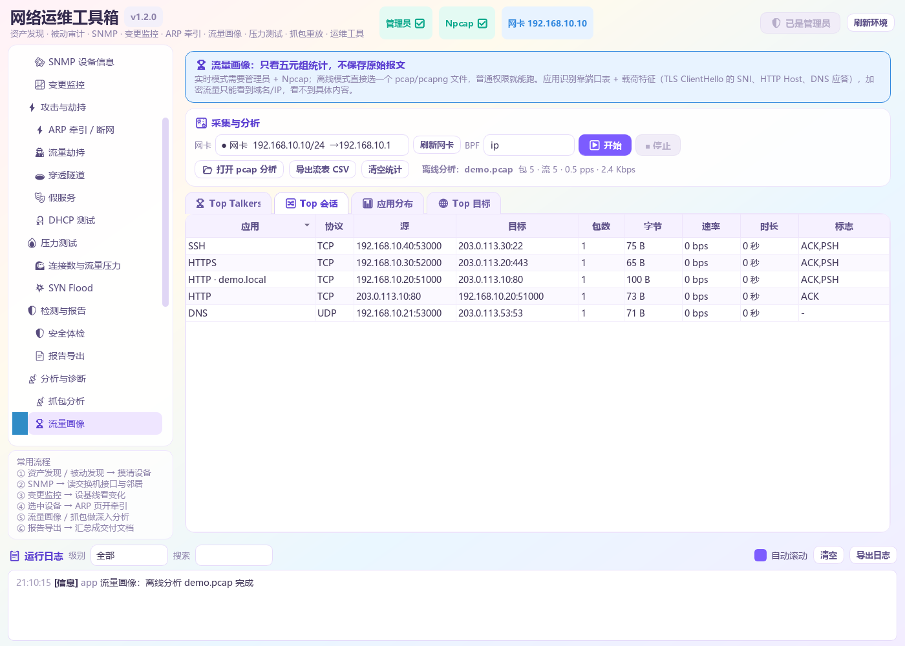
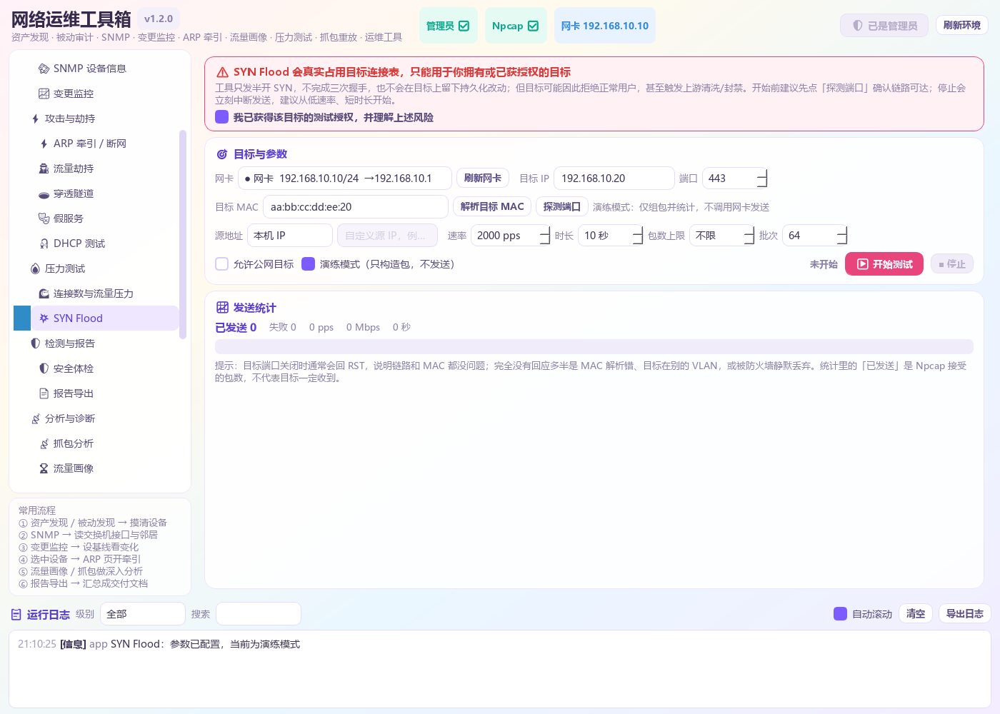
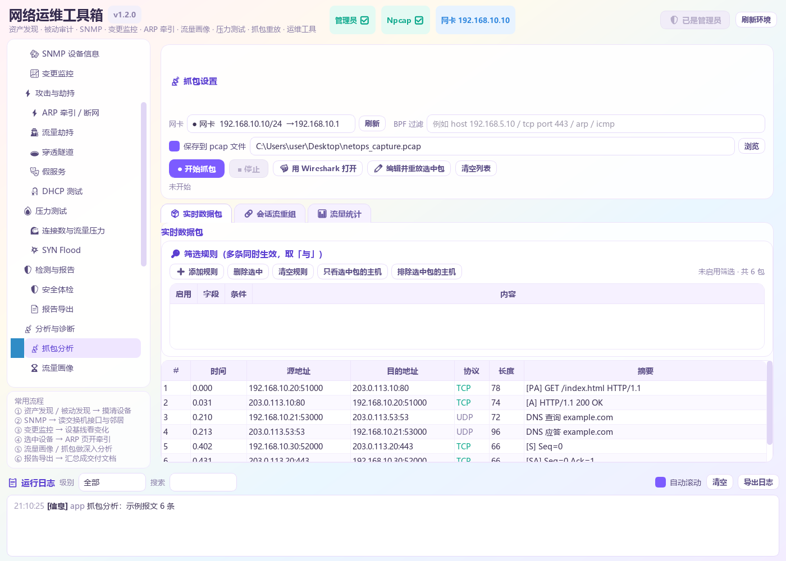
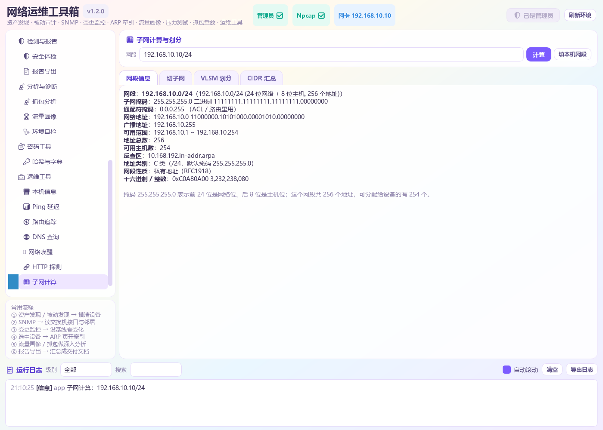

# NetOps Toolbox

**v1.2.0** · Windows 网络运维与安全测试工具箱，基于 PyQt5。

将局域网资产发现、被动审计、SNMP、变更监控、流量画像、ARP 牵引、透明代理、
抓包分析和压力测试集成在一个窗口中，适合网络排障、资产梳理与授权范围内的安全测试。

> 仅限用于本人拥有或已获得书面授权的网络与设备。

## 功能

| 分类 | 功能 |
| --- | --- |
| 发现与扫描 | 资产发现、端口扫描、目录爆破 |
| 资产与设备 | 被动发现、SNMP 设备信息、变更监控 |
| 流量牵引 | ARP 牵引 / 断网、流量劫持、穿透隧道、假服务、DHCP 测试 |
| 压力测试 | 连接数与流量压力、SYN Flood |
| 检测与报告 | 安全体检、报告导出 |
| 分析与诊断 | 抓包分析、流量画像、环境自检 |
| 其他 | 密码工具、Ping、路由追踪、DNS、子网计算、时间校准等运维工具 |

## 界面

截图中的数据均为示例。

| 资产发现 | 被动发现 |
| --- | --- |
| [](docs/screenshots/01-assets.png) | [](docs/screenshots/02-passive.png) |
| **SNMP 设备信息** | **变更监控** |
| [](docs/screenshots/03-snmp.png) | [](docs/screenshots/04-monitor.png) |
| **流量画像** | **SYN Flood** |
| [](docs/screenshots/05-flows.png) | [](docs/screenshots/06-synflood.png) |
| **抓包分析** | **子网计算** |
| [](docs/screenshots/07-capture.png) | [](docs/screenshots/08-subnet.png) |

## 运行环境

- Windows 10 / 11（64 位）
- Python 3.9+（仅源码运行需要）
- Npcap（抓包、ARP 牵引、透明代理需要；安装 Wireshark 时勾选即可）
- 管理员权限（扫描、抓包、流量牵引等功能需要）

## 安装与运行

### 直接运行 exe

从 [Releases](../../releases) 下载 `NetOpsToolbox.exe`，双击运行。
程序为单文件免安装，启动时请求管理员权限。

### 从源码运行

```powershell
python -m venv .venv
.venv\Scripts\activate
pip install -r requirements.txt
python main.py
```

`启动.vbs` 可通过 `pythonw.exe` 启动，不显示控制台窗口。

### 命令行参数

```powershell
python main.py                # 正常启动
python main.py --no-elevate   # 本次不自动提权
python main.py --selftest     # 运行自检
```

### 配置文件

首次运行生成 `config.json`，常用项：

| 配置项 | 说明 |
| --- | --- |
| `auto_elevate` | 启动时是否请求管理员权限 |
| `mitm_http_port` / `mitm_https_port` | 透明代理监听端口，默认 80 / 443 |
| `mitm_forward_to_tool` / `mitm_forward_port` | 是否转发给本机抓包工具及其端口 |
| `mitm_upstream_proxy` | 二级代理，例如 `127.0.0.1:7890` |
| `arp_interval` / `arp_restore_count` | ARP 发包间隔与恢复次数 |

## 权限

| 功能 | 权限 |
| --- | --- |
| 资产发现（Ping 模式）、端口扫描、SNMP、pcap 离线分析、运维工具 | 普通用户 |
| 变更监控（被动 / SNMP 模式）、SYN Flood 演练模式 | 普通用户 |
| ARP 扫描、被动发现、实时流量画像、抓包、透明代理 | 管理员 + Npcap |
| ARP 牵引 / 断网、SYN Flood 实际发送 | 管理员 + Npcap + 目标授权 |

## 使用说明

### 资产发现与端口扫描

目标留空会扫描当前网段，也支持 `192.168.10.0/24`、`192.168.10.10-50`
和多个网段。ARP 扫描最准确，需要管理员权限；无管理员权限时会结合 Ping
与本地 ARP 缓存补齐信息。端口扫描支持预设与自定义范围，结果可导出 CSV。

### 被动发现

在网卡上旁路监听 ARP、DHCP、mDNS、NBNS、LLDP、CDP，不发送探测报文。
资产表记录 IP、MAC、厂商、主机名与来源；告警页会提示 IP 冲突、MAC 漂移、
ARP 扫描、流氓 DHCP 和网关 MAC 被替换。选中资产可直接送入端口扫描。

### SNMP 设备信息

支持 SNMP v1 / v2c，可读取系统信息、接口表、ARP 表、IP 地址表和 LLDP 邻居，
也支持任意 OID 的 GET / GETNEXT / GETBULK 查询。团体名探测仅做只读尝试；
写入 sysName / sysLocation 需要单独授权并二次确认。

### 变更监控

选择 ARP 扫描、Ping 扫描、SNMP 或被动发现作为数据源，按设定间隔采样。
每次结果写入 `netops_history.db`，并与基线或上一份快照比较，列出新增、
消失和字段变化。历史快照可设为基线、导出 JSON 或删除。

### 流量画像

按源 / 目的 IP、端口和协议聚合五元组，仅保存统计值，不保存原始报文。
提供 Top Talkers、Top 会话、Top 目标和应用分布，支持实时抓包与 pcap 离线分析。

### ARP 牵引与流量劫持

ARP 页支持双向中间人、单向抓包和断网三种模式，可同时开启 IP 转发与 DNS 引流。
停止或正常退出时会自动恢复 ARP 表，页面另提供紧急恢复按钮。

本地抓包工具只能看到本机进程的流量。若要让目标设备的请求出现在「流量劫持」页，
需同时开启 **ARP 牵引 + DNS 引流 + 透明代理**：

1. ARP 页选择网卡与目标，模式选择「双向中间人」，勾选 IP 转发、DNS 引流和透明代理。
2. 「流量劫持」页保持监听端口为 80 / 443，启动代理。
3. 让目标访问一个 `http://` 站点，请求会出现在列表中。

HTTPS 解密需要目标设备信任本程序的根证书，可在「流量劫持」页导出
`netops-ca.crt` 后安装到目标设备。

### SYN Flood

发送半开 SYN，用于验证目标 SYN backlog 和防火墙策略。可设置速率、时长、
包数上限和批量大小，默认只允许私有网段，公网目标需显式开启。
启动前必须确认测试授权。建议先用演练模式检查参数，再从低速率、短时长开始。

### 子网计算

支持网段画像、切子网、VLSM 划分、CIDR 汇总和地址区间转 CIDR，
结果包含掩码、广播地址、可用范围、反查区和保留地址判断。

## 目录结构

```
net-ops-toolbox/
├── main.py              入口、自动提权、--selftest
├── build_exe.py         单文件 exe 打包
├── theme.py             界面样式
├── core/                核心逻辑（不依赖 Qt）
│   ├── assets.py        资产发现
│   ├── passive.py       被动发现与审计
│   ├── snmp.py          SNMP 客户端
│   ├── store.py         快照库与差异对比
│   ├── monitor.py       周期采样
│   ├── flows.py         流量画像
│   ├── synflood.py      SYN Flood
│   ├── arpmitm.py       ARP 牵引
│   ├── mitm.py          HTTP/HTTPS 透明代理
│   └── capture.py       抓包与流重组
├── ui/                  界面
├── assets/              图标
├── docs/screenshots/    界面截图
├── selftest_core.py     核心层自检
└── selftest_ui.py       界面层自检
```

## 构建与自检

```powershell
pip install pyinstaller
python build_exe.py
```

产物为 `dist\NetOpsToolbox.exe`。打包后可通过文件查看自检结果：

```powershell
.\dist\NetOpsToolbox.exe --selftest --selftest-out=selftest.txt
```

源码自检：

```powershell
python main.py --selftest
```

输出以 `=== ALL PASS ===` 结尾且退出码为 0 表示通过。

## 常见问题

**ARP 牵引已启动，但流量劫持页没有请求？**
确认已开启 DNS 引流。ARP 只让流量经过本机，目标仍连接真实服务器时，
本地代理看不到请求。

**HTTPS 无法解密或目标提示证书错误？**
目标设备未信任本程序根证书。导出 `netops-ca.crt` 并安装到受信任的根证书颁发机构。

**抓包显示运行但没有报文？**
检查网卡和 BPF 过滤规则，可先用空过滤器测试。Tailscale、Wintun 等虚拟网卡通常无效。

**退出后目标设备无法上网？**
程序会自动恢复 ARP 表。若进程被强制结束，使用「紧急恢复」按钮，
或让目标设备断开网络后重连。

**程序闪退？**
查看程序目录下的 `crash.log`。PyQt5 槽函数异常默认会终止进程，
本程序已安装全局异常处理，并会写入日志面板和 `crash.log`。

## 许可与免责

本项目使用 [MIT](LICENSE) 许可证。

ARP 牵引、流量劫持、弱口令检测、目录爆破、压力测试和 DHCP 测试等功能
仅可用于本人拥有或已获得书面授权的网络与设备。压力测试与 SYN Flood
会占用目标资源，请提前确认影响范围并在业务低峰期使用。
