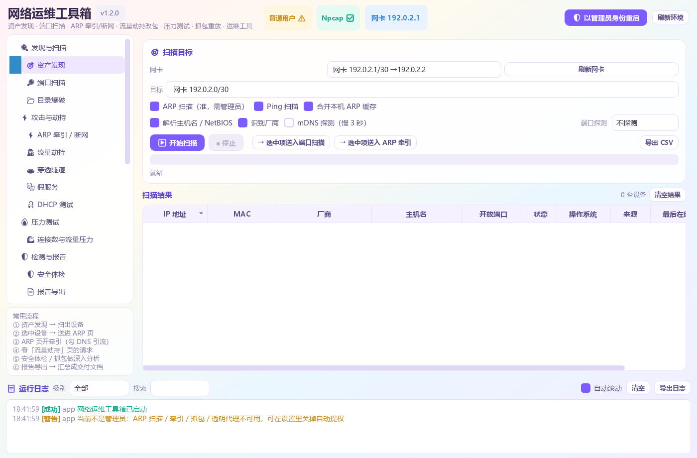
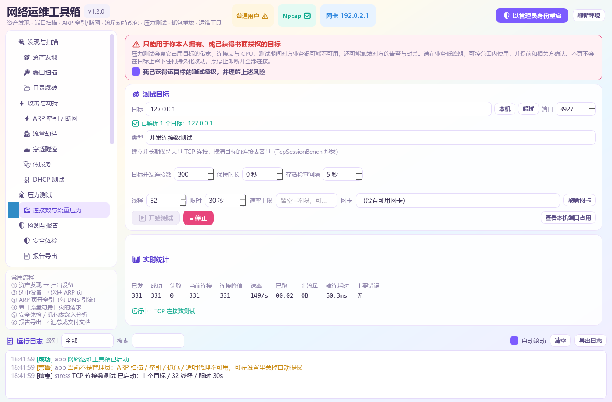
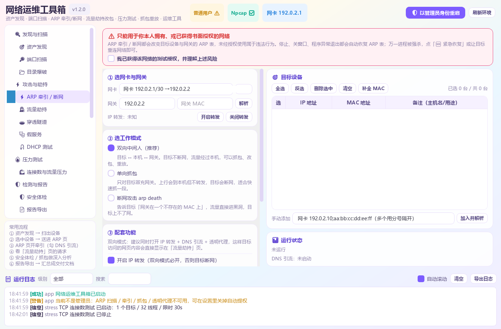
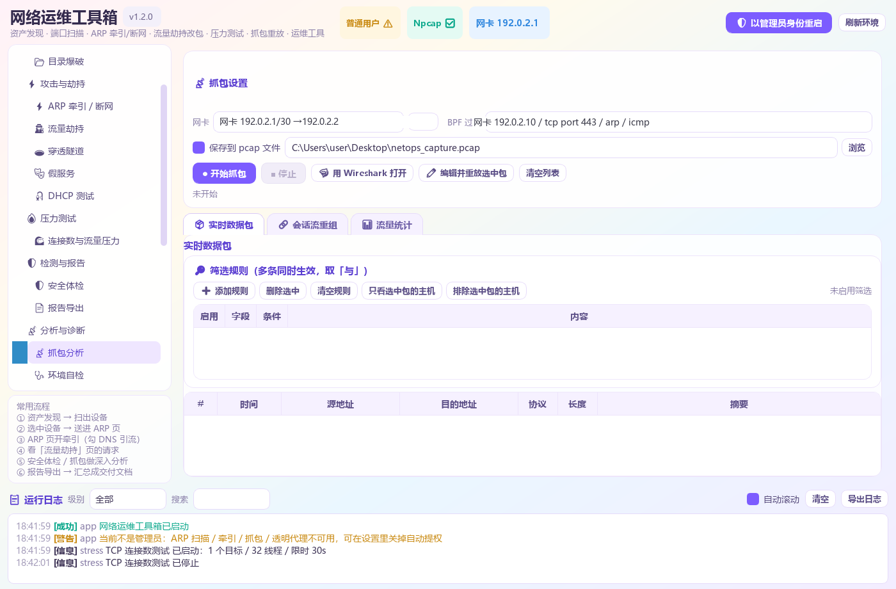
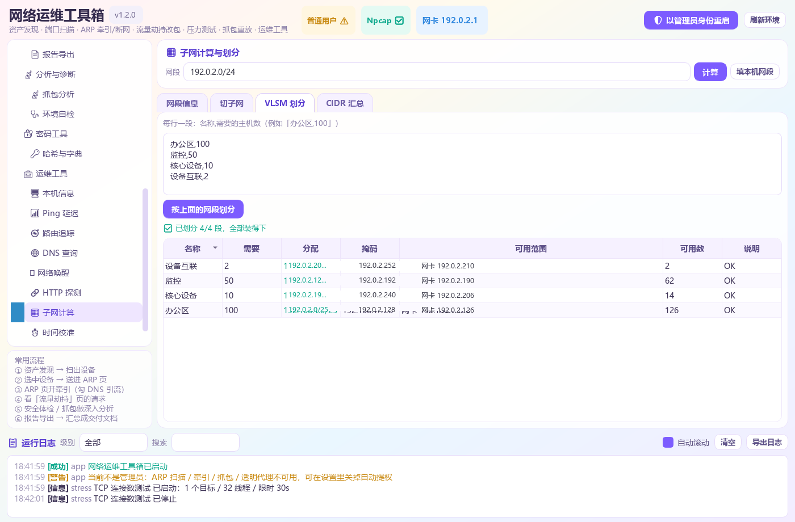
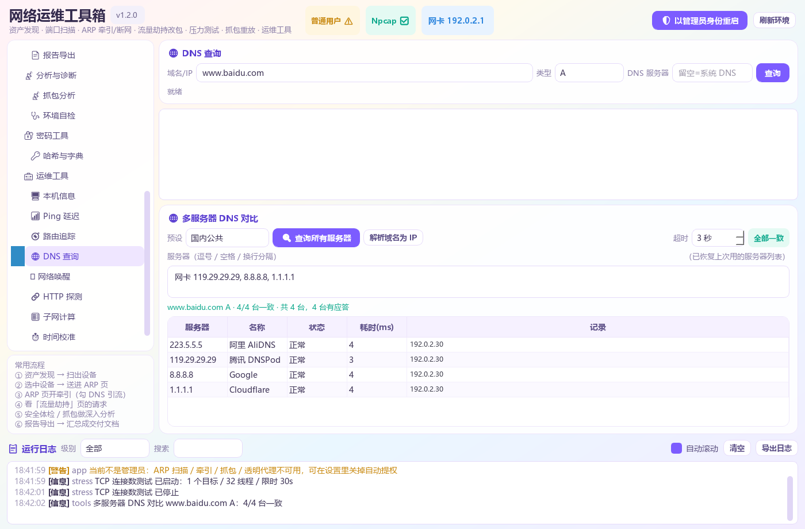
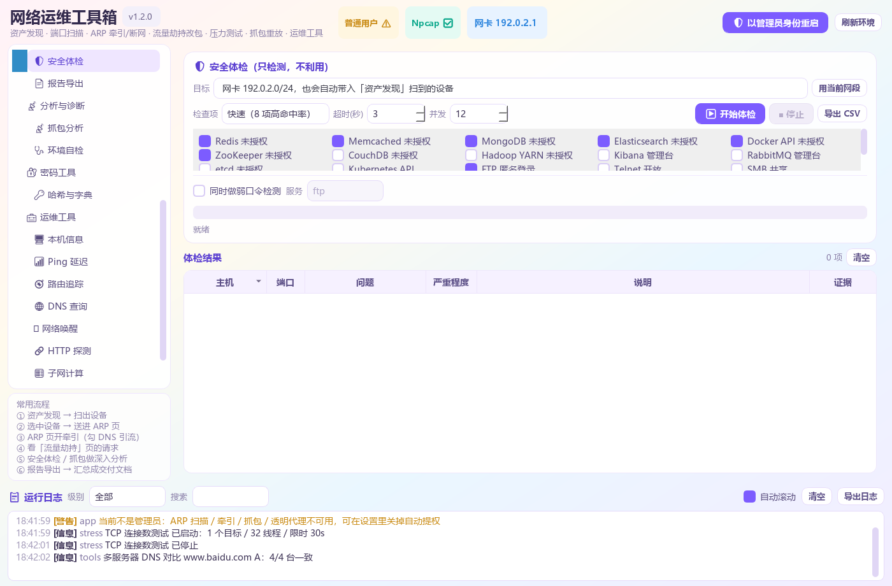

# 网络运维工具箱 · NetOps Toolbox

**当前版本 v1.2.0** ｜ 浅色多巴胺风格的 PyQt5 网络运维 / CTF 工具链，一个窗口搞定资产发现、
端口扫描、被动审计、SNMP、变更监控、ARP 牵引、流量劫持改包、流量画像、压力测试、抓包重放。

```
🎯 资产发现      ARP / Ping 扫描，识别 IP、MAC、厂商、主机名、开放端口
🔎 端口扫描      TCP connect 扫描 + Banner 抓取，11 种端口预设
🛰 被动发现      旁路监听 ARP/DHCP/mDNS/NBNS/LLDP/CDP，IP-MAC 审计与拓扑还原
🛰 SNMP 设备     手写 BER 的 v1/v2c 客户端：型号 / 接口 / ARP / LLDP 邻居
📈 变更监控      定期采样并存快照，对比新增 / 消失 / 字段变化
🏆 流量画像      五元组流表、Top Talkers、应用识别、pcap 离线分析
📂 目录爆破      948 条内置字典，自动过滤软 404
⚡ ARP 牵引/断网   双向中间人 / 单向抓包 / 断网攻击(arp death) + DNS 引流
🕵 流量劫持      内建 HTTP/HTTPS 透明代理：看请求、改包重放、下断点
🎣 DHCP 测试     局域网 DHCP 分配审计 / 地址池耗尽测试 / 假 DHCP 服务器
🔥 压力测试      并发连接数测试 + TCP/UDP/ICMP/HTTP 压力 + Slowloris
💥 SYN Flood     发半开 SYN 验证 SYN backlog（需显式授权，默认只允许私有目标）
🛡 安全体检      未授权访问 / 错误配置的只读指纹扫描
📡 抓包分析      scapy 实时抓包、TCP 流重组、过滤规则、包编辑重放
🧮 子网计算      网段画像 / 切子网 / VLSM 划分 / CIDR 汇总 / 区间转 CIDR
🌐 多服务器 DNS  一次并发问多台 DNS，并排对比谁跟谁不一样
🧰 运维工具      本机信息 / Ping 曲线 / 路由追踪 / DNS / WOL / HTTP / 时间
```

---

## 界面预览

左侧一棵导航树，右侧内容区，底部常驻运行日志 —— 所有功能页都平铺在这棵树里，
点一下即切换。



几个主要功能页：

| 🔥 压力测试（本机自测） | 🎣 DHCP 测试 |
| :---: | :---: |
| [](docs/screenshots/02-stress.png) | [](docs/screenshots/03-dhcp.png) |
| **⚡ ARP 牵引 / 断网** | **🕵 流量劫持** |
| [](docs/screenshots/04-arp.png) | [](docs/screenshots/05-mitm.png) |
| **📡 抓包分析** | **🧮 子网计算 / VLSM** |
| [](docs/screenshots/06-capture.png) | [](docs/screenshots/07-subnet.png) |
| **🌐 多服务器 DNS 对比** | **🛡 安全体检** |
| [](docs/screenshots/08-dns.png) | [](docs/screenshots/09-vuln.png) |

> 点图片看原图。压力测试那张是**对着本机 127.0.0.1 跑**出来的真实数字，
> 没有碰任何外部目标。
>
> 截图里的网卡 IP、网关、MAC 与用户名路径都已替换成示例值
> （`192.0.2.x`（RFC 5737 文档地址）/ `aa:bb:cc:dd:ee:ff` / `C:\Users\user`），
> 认不出类型的虚拟网卡名也统一显示为「网卡」。

---

## 一、安装与运行

**不想装 Python**：到 [Releases](../../releases) 下载 `NetOpsToolbox.exe`，单文件免安装，
双击即用（会自己弹 UAC 提权）。抓包和 ARP 牵引需要机器上装有 **Npcap**，
装 Wireshark 时勾选即可。

想改代码就跑源码：

```powershell
conda activate ai
cd net-ops-toolbox
pip install -r requirements.txt

python main.py          # 启动（会自动弹 UAC 请求管理员权限）
```

**想完全没有控制台黑窗**：直接双击 **`启动.vbs`**。
它用 `pythonw.exe`（GUI 子系统程序）启动，不会有任何 cmd 窗口；
自动提权时同样用 `pythonw`，所以提权后也不会闪黑窗。

其他参数：

```powershell
python main.py --no-elevate    # 本次不自动提权
python main.py --selftest      # 核心层自检，不弹界面
```

配置写在同目录的 `config.json`（首次运行自动生成），常用项：

| 键 | 说明 |
| --- | --- |
| `auto_elevate` | 启动是否自动请求管理员（默认 true） |
| `mitm_http_port` / `mitm_https_port` | 透明代理监听端口（默认 80 / 443） |
| `mitm_forward_to_tool` / `mitm_forward_port` | 是否把流量转交给本机抓包工具（Reqable / Fiddler / Burp 等）及其监听端口 |
| `mitm_upstream_proxy` | 二级代理，例如 `127.0.0.1:7890` |
| `arp_interval` / `arp_restore_count` | ARP 发包间隔、停止时恢复次数 |

### 权限

| 功能 | 权限 |
| --- | --- |
| 资产发现（Ping 方式）、端口扫描、全部运维小工具 | 普通用户 |
| SNMP 查询、变更监控（被动 / SNMP 模式）、pcap 离线分析、SYN Flood 演练模式 | 普通用户 |
| ARP 扫描、被动发现、实时流量画像、抓包、**透明代理** | **管理员 + Npcap** |
| SYN Flood 真实发送、ARP 牵引 / 断网 | **管理员 + Npcap + 目标授权** |

---

## 二、重点：为什么 Reqable / Fiddler 看不到被 ARP 那台机器的流量？

这是最常见的一个误解，原因很实在：

> **Reqable / Fiddler 是"本地代理"，只能拦到「本机进程发起」的连接。**
> ARP 牵引只是让目标的流量**经过**本机（二层转发），
> 目标 TCP 连接的目的 IP 仍然是真实服务器 —— 这些包根本不会进本机代理的套接字。

要让目标设备访问的网站内容直接显示在本机，必须再补一步 **DNS 引流**：

```
① ARP 牵引    目标设备的流量先到本机（否则它的 DNS 请求也无法到达）
② DNS 引流    收到域名查询时抢先应答「A 记录 = 本机 IP」  ← 关键
③ 于是它直接连到本机的 80/443，本机透明代理就拿到了明文
```

工具箱把这三步做成了一键：在 **⚡ ARP 牵引 / 断网** 页把
`DNS 引流` 和 `同时启动内建透明代理` 都勾上，点开始，
然后切到 **🕵 流量劫持** 页 —— 目标访问的网页请求就会一条条出现。

### 具体操作步骤（照这个来）

**第 1 步 · ARP 页**
- 网卡选对（有网关的那块）
- 模式选 **双向中间人（推荐）**
- 勾上 **开启 IP 转发**、**DNS 引流**、**同时启动内建透明代理**
- 勾选目标设备 → 点「开始」

**第 2 步 · 流量劫持页**
- **端口保持 80 / 443**（这是「目标连过来的端口」，**不是**抓包工具的监听端口）
- 点「启动代理」
- 让目标设备打开一个 **http://** 网站（不要用 https，先排除证书问题）

**第 3 步 · 看结果**
- 请求出现在「请求列表」里 → 成功，可以改包重放了
- 还是空的 → 点 **「🔍 引流自检」**，它会逐环告诉你卡在哪

### ⚠️ 最常见的三个坑

| 现象 | 原因 | 解决 |
| --- | --- | --- |
| 代理显示在跑，一个包都没有 | **监听端口填成了别的抓包工具占着的端口**。Windows 上 `SO_REUSEADDR` 会让两个进程都绑成功，但连接全被先绑的那个接走 | 监听端口改回 **80 / 443**；想用抓包工具就勾「转交给本地抓包工具」，把**它自己的**端口填到那一栏 |
| 有 ARP 流量但代理没反应 | **没开 DNS 引流**。目标的流量只是「经过」本机，目的 IP 还是真实服务器 | 回 ARP 页勾上 DNS 引流，重新开始 |
| DNS 劫持数是 0 | 目标在用 **DoH / DoT**（加密 DNS），或者它直接用 IP 访问 | 在目标设备上关掉「安全 DNS / DoH」（Chrome：设置→隐私→安全→关闭「使用安全 DNS」），或换用目标 |

**HTTPS 额外一步**：点「导出根证书」，把 `netops-ca.crt` 装到**目标设备**的
「受信任的根证书颁发机构」里，否则它连不上（浏览器会报证书错误）。

### 想继续用 Reqable / Fiddler

在「流量劫持」页勾上 **「把流量转交给本地抓包工具」** 并填它的监听端口
（各个工具默认值不一样，在它自己的设置里能看到）。工具箱会把被劫持的连接
转成代理请求（HTTP 走代理格式、HTTPS 走 CONNECT 隧道）交给它处理。
**注意：本程序的监听端口仍然是 80/443，两者不是一回事。**

> **HTTPS 的前提**：不管用哪种方式，要解密 HTTPS 都得让**目标设备信任签发证书的根 CA**。
> 用「导出根证书」把 `netops-ca.crt` 导出，装到目标设备的
> 「受信任的根证书颁发机构」里即可（Fiddler 用 Fiddler 自己的 CA，同理）。

---

## 三、界面怎么用

打开后是 **左侧一棵导航树 + 右侧内容区**，整条工具链都平铺在这棵树里，
点一下即切换，不用在两层标签页里找：

```
🔍 发现与扫描
   🎯 资产发现        扫局域网：IP / MAC / 厂商 / 主机名 / 开放端口（可开深度探测做 TTL 系统指纹）
   🔎 端口扫描        TCP 扫描 + Banner 抓取
   📂 目录爆破        948 条内置字典，自动过滤软 404
🛰 资产与设备
   🛰 被动发现        旁路监听 ARP/DHCP/mDNS/NBNS/LLDP/CDP，做 IP-MAC 审计与拓扑还原
   🛰 SNMP 设备信息   v1/v2c 读取型号、接口表、ARP 表、LLDP 邻居（只读为主）
   📈 变更监控        定期采样并存快照，对比出新设备 / 消失设备 / 字段变化
⚡ 攻击与劫持
   ⚡ ARP 牵引 / 断网   双向中间人 / 单向抓包 / 断网(arp death) + DNS 引流
   🕵 流量劫持        看被牵引设备的请求，改包重放、下断点
   🕳 穿透隧道        端口转发（TCP/UDP）+ 正/反向 shell 交互控制台
   🎭 假服务          一键起 DNS / HTTP 服务，配合引流做取证演示
   🎣 DHCP 测试       被动审计局域网 DHCP 分配 / 地址池耗尽测试 / 假 DHCP 服务器
🔥 压力测试
   🌊 连接数与流量压力 并发 TCP 连接数测试 + TCP/UDP/ICMP/HTTP 压力 + Slowloris 慢速连接
   💥 SYN Flood       发半开 SYN 验证目标 SYN backlog；需授权，建议先低速率短时长
🛡 检测与报告
   🛡 安全体检        Redis/MongoDB/Docker/FTP… 未授权访问与错误配置快速指纹扫描
   📄 报告导出        把各页结果汇总成 Markdown / HTML 报告
📡 分析与诊断
   📡 抓包分析        实时抓包、TCP 会话重组导出、流量统计图、编辑重放、跳 Wireshark
   🏆 流量画像        五元组流表 + Top Talkers + 应用识别 + pcap 离线分析
   🩺 环境自检        权限/网卡/端口/防火墙体检 + 无害发包自检 + 导出报告
🔐 密码工具
   🔑 哈希与字典      哈希识别、字典爆破、社工字典生成
🧰 运维工具
   🖥 本机信息  📶 Ping 延迟  🧭 路由追踪  🌐 DNS 查询（含多服务器对比）
   ⏻ 网络唤醒  🔗 HTTP 探测  🧮 子网计算（含 VLSM / 汇总）  ⏱ 时间校准
```

左下角常驻一个 **「常用流程」** 提示卡；底部 **运行日志** 面板与主区域的
分隔条可以拖动调整高度。

### 新增工具速览

| 工具 | 能干什么 |
| --- | --- |
| **🌊 连接数与流量压力** | 把 TcpSessionBench 那类「并发连接数压测」和常见压力测试合并到一页：**并发连接数测试**（建立并长期保持大量 TCP 连接、周期存活探测、掉线自动重连）、**TCP**（connect / syn 两种模式）、**UDP**、**ICMP**、**HTTP**（可指定方法、复用连接、随机路径与 UA）、**Slowloris 慢速连接**。支持自定义 IP / 域名 / 端口，域名自动解析，实时看已发 / 成功 / 失败 / 当前连接 / 峰值 / 速率 / 建连耗时与错误分布；带限时自动停止与授权确认 |
| **🎣 DHCP 测试** | ① **被动审计**：只听不发，列出局域网里「谁从哪台 DHCP 拿了什么地址、主机名是什么」，排查私接路由器最直接；② **地址池耗尽测试**：用随机 MAC 连发 DISCOVER/REQUEST 占满地址池，验证 DHCP Snooping / 端口安全策略是否生效；③ **假 DHCP 服务器**：下发我们指定的网关与 DNS，配合 ARP 牵引接管整段流量 |
| **🧮 子网计算** | 不只是「网络号 + 广播号」：通配符掩码、二进制掩码、反查区名、地址类别、是否保留段（RFC1918 / CGNAT / 链路本地 / 组播…）；**切子网**（按前缀或按数量自动挑）；**VLSM 划分**（按各段主机需求从大到小分配，尽量少浪费）；**CIDR 汇总**（多条路由并成最少的几条）；**区间转 CIDR**（写防火墙白名单用） |
| **🌐 多服务器 DNS** | 一次并发问多台 DNS 并排对比：内置「国内公共 / 国际公共 / 路由器内网 / DoH 服务器地址」四组预设，也可以自己填任意服务器（逐条校验，非法直接报错不静默丢弃）。显示每台的记录 / 状态 / 耗时，并给出**一致性结论**（`8/9 台一致` 或 `发现 2 种不同结果（可能存在分区域解析或劫持）`）。比较时忽略应答顺序，A 记录轮询不会误报 |
| **📂 目录爆破** | 948 条 CTF/渗透常见路径（`.git/HEAD`、`.env`、备份包、Swagger、flag…）× 8 种后缀，先探两个随机路径建立**软 404 基线**自动过滤假 200，结果可双击用浏览器打开、导出 CSV |
| **🛡 安全体检** | 20 项**只读探针**：Redis / Memcached / MongoDB / Elasticsearch / Docker API / ZooKeeper / CouchDB / YARN / Kibana / RabbitMQ / etcd / K8s 未授权，FTP 匿名、rsync 未授权、`.git` 泄露、VNC 无认证、目录列表… 按严重程度排序。弱口令检测默认关闭、需二次确认 |
| **🕳 穿透隧道** | TCP/UDP 端口转发（等价 lcx / netsh portproxy 的 GUI 版）；反向 shell 监听 + 交互控制台（命令历史、行尾选择）；正向连接。**只做连接管理与字节收发，不生成 payload、不做免杀/持久化** |
| **🎭 假服务** | 一键起本地 DNS（可配 A 记录、未命中转发上游或 NXDOMAIN）和 HTTP（固定内容 / 目录托管），带实时请求日志，配合引流做取证或钓鱼演示 |
| **📄 报告导出** | 一键采集资产 / 端口 / 安全体检 / HTTP 流量 / 目录爆破的结果，渲染成 Markdown 或 HTML（带风险配色和统计卡片） |
| **🔑 哈希与字典** | 识别 MD5/SHA/NTLM/bcrypt/`$6$`/JWT/Base64 等；字典爆破（内置 150 条弱口令 / 文件 / 自定义）；社工字典生成（姓名+年份+弱后缀组合） |
| **📡 抓包增强** | TCP 载荷按方向重组，可把「下载下来的文件」直接导出成二进制；协议分布 + Top 会话柱状图 |
| **🛰 被动发现** | 只旁路监听、不发任何探测包：解析 **ARP / DHCP / mDNS / NBNS / LLDP / CDP**，自动维护 IP↔MAC 资产表、DHCP 客户端表与交换机邻居拓扑。内置审计规则：**IP 冲突、MAC 漂移、ARP 扫描、流氓 DHCP、网关 MAC 被顶替**；可一键生成中文审计结论、导出资产 CSV，选中主机直接送进端口扫描 |
| **🛰 SNMP 设备信息** | **手写 BER 编解码**，不依赖 pysnmp：v1 / v2c 的 GET / GETNEXT / GETBULK，读系统信息、接口表、ARP 表、IP 地址表、LLDP 邻居；附常见团体名探测（只读）与配置风险报告（默认团体名、设备位置泄露等）。写入 sysName / sysLocation 默认隐藏，必须勾选授权并二次确认 |
| **📈 变更监控** | 按固定周期对同一目标采样（ARP 扫描 / Ping 扫描 / SNMP / 被动发现任选），把每次结果写进 **SQLite 快照库**，与基线或上一份快照做**字段级差异**：哪些设备新上线、哪些消失、哪个字段从什么变成了什么。历史快照可浏览、设基线、导出 JSON、按数量清理 |
| **🏆 流量画像** | 五元组流表实时聚合，输出 **Top Talkers / Top 会话 / Top 目标 / 应用分布**；按端口与载荷识别 TLS（SNI）、HTTP（Host）、DNS、SSH 等应用；抓包只做统计**不落原始报文**；也能直接打开 **pcap 做离线分析**，流表可导出 CSV |
| **💥 SYN Flood** | 发半开 SYN 验证目标 SYN backlog / 防火墙策略：可设**速率、时长、包数上限、批量大小**，先「探测端口」确认服务在线，再「解析目标 MAC」；内置**演练模式**（只组包不发送）。默认**拒绝公网目标**，必须显式勾选授权，只允许你拥有或已获授权的目标 |

---

### 卡住了？先看「🩺 环境自检」

被牵引设备的流量看不到、ARP 不生效之类的问题，直接点这一页的 **「重新体检」**，
它按链路顺序逐项打勾，**从上往下第一个 ❌ 就是卡住的地方**：

```
❌ ① 管理员权限：当前是普通用户
      → 关掉程序，重新启动并在 UAC 弹窗点「是」（或双击 启动.vbs）
✅ ③ 网卡：WLAN  192.0.2.22/24  网关 192.0.2.1
✅ ④ HTTP 监听端口 80：可以监听
❌ ⑤ 防火墙：Public 配置文件已开启，且没有入站放行规则
      → 点「放行防火墙端口」
❌ ⑦ DNS 引流：未启动
      → 回到 ARP 页勾上「DNS 引流」，重新开始牵引
```

配套还有 **「🔧 发包自检」**（只发正常的 ARP 请求，不做任何欺骗）：
检查本机 MAC / Npcap 设备名 / 能否向网关发包并收到应答 / 能否 ping 通目标 /
**目标 MAC 是否正确**。以及 **「导出报告」**，出问题直接贴给别人看。

---

## 四、各页面说明

### ⚡ ARP 牵引 / 断网

界面按四步排布，不会一屏按钮糊脸：

```
① 选网卡与网关  ② 选工作模式  ③ 选配套功能  ④ 开始
```

| 模式 | 效果 |
| --- | --- |
| **双向中间人** | 目标 ↔ 本机 ↔ 网关。目标不断网，流量经过本机，可抓包/改包/重放 |
| **单向抓包** | 只对目标冒充网关。目标会**断网**，适合快速抓一段 |
| **断网攻击 arp death** | 告诉目标「网关在一个不存在的 MAC 上」，流量进黑洞，直接踢下线 |

目标列表支持：全选 / 反选 / **删除选中**（或按 Delete）/ 清空 / **补全 MAC**；
IP、MAC、备注三列都能**双击直接改**（MAC 会自动规范成 `aa:bb:cc:dd:ee:ff`）；
从「资产发现」页导入时，已存在的行如果缺 MAC 会**自动补上**。

> 🛑 只能用于你本人拥有或已获书面授权的网络。
> 停止、关窗口、程序异常退出（`atexit`）都会自动把正确的 ARP 映射连发多次恢复；
> 另有独立的「🆘 紧急恢复」按钮。

### 🕵 流量劫持

* 实时请求列表：方法 / 状态码 / 主机 / 路径 / 大小（按时间顺序，不自动排序）
* 请求与响应全文，正文自动 gunzip / de-chunk
* **改后重放**：上面那块请求报文可以直接编辑（改请求行、头部、正文），点一下重发
* **断点**：填 URL 关键字或正则 → 命中就挂起，然后人工「放行挂起 / 丢弃挂起」；
  也可以开「挂起全部请求」做逐步调试
* 导出根证书、打开证书目录

### 📡 抓包分析

* scapy 实时抓包 + BPF 过滤 + 落盘 pcap + 一键用 Wireshark 打开
* **编辑并重放**：列表里选中任意一个包 → 改 MAC / IP / 端口 / TCP 标志 / 载荷 → 重新发出去
* 实时显示各协议包数与 pps

### 🏆 流量画像

按**五元组**（源/目 IP、源/目端口、协议）聚合，只保留统计值，**不保存原始报文**：

* **Top Talkers / Top 会话 / Top 目标**：按字节数排序，会话显示应用、包数、字节数、速率、持续时长与 TCP 标志
* **应用识别**：端口优先（HTTPS / HTTP / DNS / SSH…），再从载荷里取
  **TLS ClientHello 的 SNI** 与 **HTTP 的 Host**，所以 443 上的真实域名也能看出来
* **应用分布**：各应用占用字节比例
* 实时模式需要管理员 + Npcap；也可以**打开 pcap 做离线分析**，流程与实时一致
* 流表可导出 CSV；「清空统计」只清当前视图，不影响已导出的文件

### 🎯 资产发现

留空=当前网段，也支持 `192.0.2.0/24`、`192.0.2.10-50`、逗号分隔多段、域名。
ARP 扫描（需管理员）最快最准；**没有管理员时**程序会在 ping 扫描之后再读一遍
本机 ARP 缓存，同样可以补齐 MAC 与厂商信息。
主机名来自 反向 DNS → NetBIOS → 可选 mDNS；厂商来自 500+ 内置 OUI + 可更新的 IEEE 库。

### 🔎 端口扫描

11 种预设 + 自定义（`22,80,8000-8100`），并发/超时/Banner 可调，导出 CSV。
如果开放比例异常高会给出黄色警告 —— 那通常是本机安全软件在伪造 TCP 握手，
不是目标真的全开。

### 🛰 被动发现

**只听不发**：在选定网卡上旁路监听，不向网络发任何探测包，所以不会惊动任何设备。
可勾选 **ARP / DHCP / mDNS / NBNS / LLDP / CDP** 六类协议，程序会根据勾选自动拼 BPF。

| 标签页 | 内容 |
| --- | --- |
| **🖥 资产表** | IP、MAC、厂商、主机名、DHCP 厂商类、来源（ARP / DHCP / mDNS…）、最后出现时间。同一 IP 换 MAC 会保留历史 MAC |
| **📡 事件流** | 最近收到的 ARP / DHCP / mDNS / NBNS / LLDP / CDP 事件，带时间、源目地址与一句话摘要 |
| **🔗 拓扑邻居** | 从 LLDP / CDP 解析出的交换机 / 路由器邻居：设备名、端口、平台、管理地址 |
| **⚠ 告警** | **IP 冲突、MAC 漂移、ARP 扫描、流氓 DHCP、网关 MAC 被顶替**，按严重程度排序 |
| **📋 审计结论** | 把上面的发现翻译成中文结论，例如「192.0.2.20 存在 IP 冲突 / ARP 欺骗迹象」 |

填了「受信任 DHCP 服务器」后，只有不在名单里的 DHCP 应答才会报流氓服务器；
填了网关 IP + MAC 后，网关 MAC 被替换会单独告警。资产表可导出 CSV，
选中主机点「→ 选中项送入端口扫描」即可接着扫端口。

### 🛰 SNMP 设备信息

不依赖 pysnmp，**BER 编解码是自己写的**，只实现 v1 / v2c 客户端（不监听 161 端口）。

* **一键读取**：系统信息（型号 / 描述 / 运行时长 / 联系人 / 位置）、接口表（名称 / 状态 / 速率）、
  ARP 表、IP 地址表、LLDP 邻居
* **任意 OID 查询**：GET / GETNEXT / GETBULK，结果带 OID 中文名与可读值
  （TimeTicks → `00:02:03`、接口速率 → `1 Gbps`、IpAddress → 点分十进制）
* **团体名探测**：只读尝试常见默认值（`public` / `private` / `cisco` …），
  命中只说明「读权限没关」，不会做任何写入
* **配置风险报告**：默认团体名、系统描述泄露型号与固件、设备位置信息可被读取等
* **写入**：sysName / sysLocation 默认收起，必须勾选「已获授权」并二次确认，
  适合实验设备改回原值；生产设备请直接走网管系统

### 📈 变更监控

选一个数据源（**ARP 扫描 / Ping 扫描 / SNMP / 被动发现**），设采样间隔后开始监控。
每次采样都会写进 `netops_history.db`（SQLite），并在界面上与**基线**或**上一份快照**对比：

* **新增**：这次出现、基线里没有的设备
* **消失**：基线里有、这次没出现的设备
* **变化**：同一个 key（默认 IP）下，MAC、主机名、开放端口等字段的具体变化，
  精确到「哪个字段从什么变成了什么」

历史快照列表可以浏览每份快照的行数与时间，支持**设为基线**、**与最新快照对比**、
**导出 JSON**、**删除选中**。ARP / Ping 扫描需要管理员 + Npcap；
被动发现模式直接复用「🛰 被动发现」页正在跑的采集器，不额外发包。

### 🌊 连接数与流量压力

把 TcpSessionBench 那类「并发连接数压测」和常见压力测试合并成一页。目标支持
IP、域名、网段与逗号分隔的多个目标，**域名会在开跑前自动解析**，端口随便填。

| 类型 | 说明 |
| --- | --- |
| **并发连接数测试** | 建立并**长期保持**大量 TCP 连接，周期性做存活探测（`MSG_PEEK`），被对端关掉的自动补上。用来摸清目标的连接表容量，以及压力下新连接还能不能建起来 |
| **TCP 压力** | `connect` 模式跑完整三次握手再断开（免管理员）；`syn` 模式发半开连接（需管理员 + Npcap，可选随机源 IP） |
| **UDP 压力** | 持续发随机长度载荷，不需要管理员 |
| **ICMP 压力** | Echo Request 洪泛（需管理员 + Npcap） |
| **HTTP 压力** | 可选 GET/POST/HEAD/PUT、HTTPS、复用连接；随机在内置路径与 UA 里挑，避免被一条规则一刀切 |
| **Slowloris** | 请求头永远不发完，并每隔 N 秒补一行没用的头续命，占住服务端连接槽 |

实时统计：已发 / 成功 / 失败 / 当前连接 / 连接峰值 / 速率 / 已跑时长 / 出流量 /
建连耗时（均值与 P95）/ 错误按类归并计数。可以设**限时**到点自动停。

> **连接数上不去先看这里**：页面右下角有「查看本机端口占用」。Windows 默认动态端口
> 只有约 1.6 万个，连接数测试很容易**先把自己的端口用光**，看到状态里出现
> `本机端口耗尽（WSAENOBUFS）` 就说明瓶颈在本机，不是目标扛不住。

### 💥 SYN Flood

发半开 SYN、不完成三次握手，用来验证目标的 **SYN backlog 容量**与防火墙 /
负载均衡的半开连接策略。页面按「目标 → 网卡 → 参数 → 授权」排布：

| 参数 | 说明 |
| --- | --- |
| **目标 IP / 端口** | 默认只允许**私有网段 / 链路本地**地址；公网目标必须显式勾选「允许公网目标」 |
| **目标 MAC** | 点「解析目标 MAC」自动查；跨网段时填网关 MAC。**没有目标 MAC 不允许启动** |
| **速率 / 时长 / 包数** | 速率支持 `1000`、`2k`、`1M` 这类写法，`0` 表示不限速；时长与总包数都可设上限，先到先停 |
| **批量大小** | 每个发送周期组多少个包，影响实际 pps 与 CPU 占用；页面会估算 pps 与 Mbps |
| **演练模式** | 只按参数构造包、走完整个统计流程，但**不调用网卡发送**，用来验证配置和观察 UI |

启动前必须先勾选「我已获得该目标的测试授权」，并再确认一次。发送线程只有一个，
所有包都经 `core/rawsock.send_packets()` 串行化发出，且每个包都带
`Ether(src=本机 MAC)`。实时统计：已发 / 失败 / 实际速率 / 已跑时长；
停止后不会留下任何后台线程。

> ⚠️ SYN Flood 会真实占用目标连接表。请只在**你拥有或已获书面授权**的目标上、
> 从低速率短时长开始，并先在演练模式确认参数。

### 🎣 DHCP 测试

| 模式 | 说明 |
| --- | --- |
| **DHCP 审计（被动）** | 只听不发，列出局域网里「哪台设备从哪台 DHCP 拿了什么地址、主机名是什么」，按服务器归类。排查私接路由器 / 找出乱发地址的设备最直接 |
| **地址池耗尽测试** | 用随机（或指定前缀的）MAC 连发 DISCOVER，可选跟完 REQUEST，把地址池占满。用来验证交换机的 **DHCP Snooping / 端口安全** 策略有没有真正生效 |
| **假 DHCP 服务器** | 回应 DISCOVER/REQUEST，下发**我们指定的网关和 DNS**。配合 ARP 牵引就能把整段流量接管过来；也是演示「插个家用路由进 LAN 会怎样」的标准做法 |

> 这三种都带独立的授权确认勾选。**假 DHCP 和耗尽测试会直接影响整段局域网的
> 正常上网**，请只在你自己拥有或已获授权的网络里、并在业务低峰期使用。
> 停止即断开，不会在目标上留下持久化改动。

### 🧮 子网计算 / 划分

比「网络号 + 广播号」多得多：

* **网段画像**：掩码、**通配符掩码**、二进制掩码、广播地址、可用范围、地址总数、
  可用主机数、**反查区名（in-addr.arpa）**、地址类别、是否落在保留段
  （RFC1918 / CGNAT / 链路本地 / 组播…）、十六进制与整数表示
* **切子网**：按目标前缀切，或按「至少要几个」自动挑前缀
* **VLSM 划分**：按各段的实际主机需求（每行「名称,需要的主机数」）从大到小依次
  分配，尽量少浪费地址；空间不够会明确标出哪一段装不下
* **CIDR 汇总**：把一堆网段并成最少的几条路由（`192.0.2.0/25` +
  `192.0.2.128/25` → `192.0.2.0/24`）
* **区间转 CIDR**：`198.51.100.5-198.51.100.200` → 9 条 CIDR，写防火墙白名单省事

### 🌐 多服务器 DNS 对比

DNS 查询页在原「单台查询」之外新增一块对比区：一次**并发**问多台 DNS，并排看结果。

* 内置四组预设：**国内公共** / **国际公共** / **路由器·内网** / **DoH 服务器地址**
* 也可以自己填任意服务器；**逐条校验，非法地址直接报错**而不是静默丢掉
  —— 否则你以为查了 8 台、实际只查了 7 台，结论会骗人
* 表格显示每台的 记录 / 状态 / **耗时(ms)**；与多数派不一致的标红，失败或超时的标黄
* 给出一致性结论：`8/9 台一致`、`发现 2 种不同结果（可能存在分区域解析或劫持）`、
  `全部 3 台都没应答（网络或防火墙问题）`
* 比较时**按集合比、忽略顺序** —— A 记录轮询和 CDN 调度会让同一份答案顺序不同，
  那不算分歧，否则天天误报劫持

### 🧰 运维工具

本机信息 / Ping 延迟折线 / 路由追踪 / DNS 查询（含上面的多服务器对比）/
Wake-on-LAN / HTTP(S) 探测（含证书到期）/ 子网计算 / SNTP 时间校准。

---

## 五、目录结构

```
net-ops-toolbox/
├── main.py                 入口（启动自动提权 / 异常兜底 / --selftest）
├── 启动.vbs                无控制台窗口启动器
├── build_exe.py            一键打包单文件 exe
├── theme.py                配色与 QSS
├── config.json             配置（首次运行生成）
├── assets/                 图标资源（app.ico / app.png）
├── docs/screenshots/       README 里的界面截图
├── certs/                  MITM 根证书与动态站点证书（首次运行生成）
├── netops_history.db       变更监控的快照库（首次使用后生成，已进 .gitignore）
├── requirements.txt
├── selftest_core.py        核心层自检
├── selftest_ui.py          界面层自检
├── tools/
│   └── make_icon.py        生成 assets/app.ico
├── core/                   与界面无关的核心逻辑
│   ├── version.py          程序名与版本号（升版本只改这里）
│   ├── paths.py            路径解析（源码运行 / exe 运行都适用）
│   ├── hostinfo.py         网卡/网关/子网/权限/提权
│   ├── subnet.py           子网画像 / 切分 / VLSM / CIDR 汇总
│   ├── assets.py           资产发现
│   ├── oui.py              内置 OUI 厂商表
│   ├── ports.py            端口扫描
│   ├── stress.py           连接数测试 + TCP/UDP/ICMP/HTTP 压力 + Slowloris
│   ├── synflood.py         SYN Flood（目标校验 / 组包 / 限速 / 演练）
│   ├── dhcpx.py            DHCP 审计 / 地址池耗尽 / 假 DHCP 服务器
│   ├── passive.py          被动发现：ARP/DHCP/mDNS/NBNS/LLDP/CDP + 审计
│   ├── snmp.py             手写 BER 的 SNMP v1/v2c 客户端
│   ├── store.py            SQLite 快照库与字段级差异对比
│   ├── monitor.py          周期采样 / 基线对比 / 三数据源适配
│   ├── flows.py            五元组流表、应用识别、pcap 离线分析
│   ├── arpmitm.py          ARP 牵引（双向/单向/断网）+ IP 转发
│   ├── dnsspoof.py         DNS 引流
│   ├── mitm.py             HTTP/HTTPS 透明拦截代理
│   ├── capture.py          抓包、流重组、过滤规则
│   ├── rawsock.py          二层收发共用套接字
│   ├── vulncheck.py        漏洞与指纹识别
│   ├── dirbrute.py         目录爆破
│   ├── tunnel.py           端口转发与反弹 shell
│   ├── fakeserv.py         假 DNS / 假 HTTP 服务
│   ├── hashkit.py          哈希计算与字典生成
│   ├── report.py           报告导出（MD / MHTML）
│   ├── netdiag.py          链路体检与防火墙操作
│   ├── tools.py            ping/traceroute/DNS（含多服务器对比）/WOL/HTTP/SNTP
│   ├── appconfig.py        配置读写
│   └── logging_bus.py      日志总线
└── ui/
    ├── main_window.py      主窗口、左侧导航、日志面板、页面联动
    ├── widgets.py          通用控件（卡片/表格/图表/日志/安全槽）
    ├── tab_assets.py  tab_ports.py  tab_dirbrute.py
    ├── tab_passive.py tab_snmp.py   tab_monitor.py
    ├── tab_arp.py     tab_mitm.py   tab_tunnel.py  tab_fakeserv.py
    ├── tab_dhcp.py    tab_stress.py tab_synflood.py
    ├── tab_capture.py tab_flows.py  tab_vuln.py    tab_report.py  tab_diag.py
    └── tab_tools.py   tab_hash.py
```

`core/` 完全不依赖 Qt，核心逻辑可以用 `python main.py --selftest` 脱离界面验证。

---

## 六、打包成单个 exe

```powershell
conda activate ai
pip install pyinstaller
python build_exe.py
```

产物是 `dist\NetOpsToolbox.exe`，**单文件、免安装、带图标**，双击即可运行
（会自己弹 UAC 提权）。打包参数都写在 `build_exe.py` 里：

* `--collect-all scapy` / `zeroconf`：这两个库大量模块是运行时才 import 的，静态分析看不到
* `CONDA_DLLS`：conda 把 OpenSSL / zlib / ffi 放在 `Library\bin`，不带上的话
  打出来的 exe 一碰 `ssl` / `hashlib` / `ctypes` 就崩
* `--add-data assets`：图标；`selftest_*.py` 也一起带上，方便直接验证打包结果

```powershell
# 打包后没有控制台，把自检结果写进文件来验证
.\dist\NetOpsToolbox.exe --selftest --selftest-out=selftest.txt

# 启动即退出时用它排查（单文件 + 控制台 + bootloader 日志）
python build_exe.py --debug
```

图标由 `tools/make_icon.py` 生成：脚本手写 ICO 容器，把 16~256 共 7 种尺寸
的 PNG 塞进同一个 `assets/app.ico`，所以任务栏、标题栏、Alt+Tab 都不会糊。
窗口图标和任务栏分组在 `main.py` 里通过 `setWindowIcon()` 与
`SetCurrentProcessExplicitAppUserModelID()` 设置。

---

## 七、常见问题

**Q：提权后还弹黑窗？**
用 `启动.vbs` 启动。自动提权本身已经改用 `pythonw.exe`，正常不会有控制台。

**Q：ARP 牵引开了，但「流量劫持」页一条都没有？**
99% 是没开 **DNS 引流**。ARP 只让流量经过本机，目标连的还是真实服务器 IP，
本地代理看不到。勾上「DNS 引流」再开始。

**Q：HTTPS 显示不出来 / 目标设备报证书错误？**
目标设备未信任本程序的根证书。到「流量劫持」页点「导出根证书」，
把 `netops-ca.crt` 装到目标设备的受信任根里。

**Q：抓包抓不到、但显示在跑？**
确认网卡选对、BPF 过滤写对（先用空过滤器试）。虚拟网卡（Tailscale、Wintun、
Wi-Fi Direct）通常抓不到有用流量。

**Q：端口扫描结果不对劲？**
见上文「开放比例异常」提示，优先怀疑本机安全软件/中间设备伪造握手。

**Q：退出后目标设备上不了网？**
程序停止/退出会自动恢复 ARP 表。如果进程被任务管理器强杀，点「🆘 紧急恢复」，
或让目标设备断网重连一次即可。

**Q：程序「闪退」了怎么办？**
先看同目录下的 **`crash.log`**（存在的话）。原因说明：

> PyQt5 在槽函数里出现未捕获异常时会直接调用 `abort()` 结束进程
> （退出码 `0xC0000409`）。若界面以 `pythonw` 启动且没有控制台，
> 表现就是毫无提示地退出。

本程序在 `main.py` 中安装了自定义的 `sys.excepthook` 与 `threading.excepthook`，
PyQt5 不会再 abort：异常会被**写入界面下方的日志面板**，同时记录到 `crash.log`，
程序继续运行。关键槽函数另外用 `@safe_slot` 做了兜底。

同目录下的 `.running` 文件用于记录运行状态与最近操作，正常退出时会被清除；
若上次未正常退出，启动时会在日志面板中提示。

`selftest_core.py` 第 9 节会完整跑一遍「启动牵引 → 停止恢复」的线程生命周期，
用于保证停止流程始终能干净收尾。

---

## 八、许可与免责

本项目采用 **[MIT](LICENSE)** 许可：可以自由使用、修改、分发、商用，
保留版权声明即可，衍生作品不强制使用同样的许可。

**免责声明：**

* ARP 牵引 / 断网、流量劫持、弱口令检测、目录爆破、压力测试、DHCP 测试等功能
  **只能用于你本人拥有、或已获得书面授权的网络与设备**。未经授权对他人网络
  使用属于违法行为。
* 压力测试（连接数 / Flood / slowloris）与 DHCP 相关功能会**实际占用目标的
  带宽、连接表和地址池**，可能在测试期间造成对方业务不可用。请在
  业务低峰期、可控范围内使用，并提前与相关方确认。
* 抓包与中间人会解密并记录经过的流量，请自行确保数据合规，用完及时停止并删除留存数据。
* 本工具按「现状」提供，不对使用后果承担任何责任。


